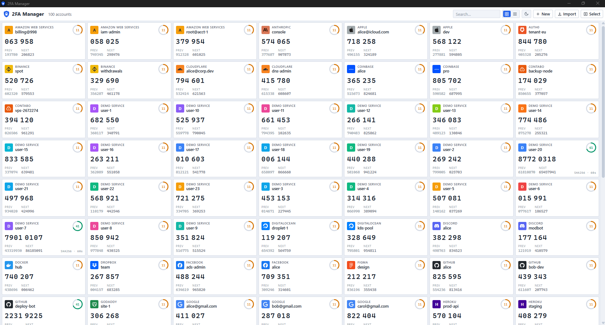
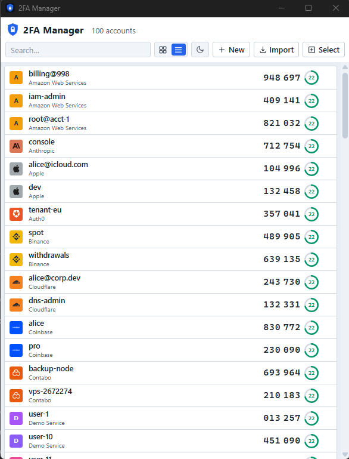

# 2FA Manager (m2fa)

A desktop TOTP authenticator built with Tauri 2, React 19, Vite 8, TypeScript and Rust.

- Import accounts from a text file with one `otpauth://` URI per line (or paste them directly)
- Live codes with **previous**, **current** and **next** windows side by side
- Card mode and list mode, search, and click-to-copy with animated feedback
- Countdown ring per account, honouring each account's own period and algorithm

## Screenshots

**Card view**



**List view**



## Security model

Secrets never touch disk in plaintext:

- Each secret is encrypted with **AES-256-GCM** (random 96-bit nonce per write) before it is written to SQLite, and the ciphertext is cryptographically bound to its account id via AES-GCM associated data — blobs cannot be swapped between rows.
- The encryption key is a random 256-bit master key stored in the **OS credential store** (Windows Credential Manager on Windows, Keychain on macOS, Secret Service on Linux) and is only fetched into memory at runtime — this is the vault.
- SQLite (`m2fa.db` in the app data directory) holds only ciphertext blobs plus non-secret metadata (label, issuer, algorithm, digits, period) and an **HMAC-SHA256 fingerprint keyed with the master key** used for duplicate detection — someone holding the database cannot verify secret guesses offline.
- Import error messages never echo the offending line or parameter values, so secrets can't leak into logs or screenshots through parse failures.
- The webview holds only generated codes and metadata; raw secrets never cross the IPC boundary. The one deliberate exception: **Export** builds `otpauth://` lines and writes them to a file in your Downloads folder entirely in Rust — the plaintext secrets go from the vault straight to disk and still never enter any webview.
- Content Security Policy is pinned to app-local assets (`default-src 'self'`, with the dev-server websocket allowed for HMR).

## Import format

One URI per line, `#` lines are skipped, duplicates (same secret + label + issuer) are reported rather than re-imported:

```
otpauth://totp/Example:alice@example.com?secret=JBSWY3DPEHPK3PXP&issuer=Example
otpauth://totp/Heroku?secret=JBSWY3DPEHPK3PXR
otpauth://totp/Acme:backup?secret=JBSWY3DPEHPK3PXU&digits=8&period=60&algorithm=SHA256&issuer=Acme
```

The parser tolerates percent-encoded and raw spaces/colons in labels and a missing `issuer` parameter. See `fixtures/sample-import.txt` for a safe dummy file to test with.

## Development

```bash
pnpm install
pnpm tauri dev      # run the app (hot reload via vite on :1420)
cargo test          # run in src-tauri: RFC vectors, vault, parser, store
```

Requirements: Node 20+, pnpm, Rust (MSVC toolchain on Windows), and the platform webview (WebView2 on Windows).

## Building and publishing

### Debug builds

`pnpm tauri dev` is the everyday loop. If you need an *installable* debug build (symbols, overflow checks on, for reproducing issues):

```bash
pnpm tauri build --debug
# installers land in src-tauri/target/debug/bundle/
```

Don't distribute debug builds — they are slower and larger.

### Release builds (local)

1. Bump the version in **both** `src-tauri/tauri.conf.json` and `src-tauri/Cargo.toml` (keep them equal).
2. Build:

   ```bash
   pnpm tauri build
   ```

3. Pick your artifacts from `src-tauri/target/release/`:

   | Artifact | Path |
   |---|---|
   | NSIS installer | `bundle/nsis/2FA Manager_<version>_x64-setup.exe` |
   | MSI installer | `bundle/msi/2FA Manager_<version>_x64_en-US.msi` |
   | Portable binary | `m2fa.exe` |

   The first run downloads WiX and NSIS automatically. Build only one format with `--bundles nsis` (or `msi`).
4. Publish a GitHub release (repo is private — only collaborators can download):

   ```bash
   git tag v0.1.0 && git push origin v0.1.0        # preferred: CI builds and attaches
   # or attach your local artifacts:
   gh release create v0.1.0 "src-tauri/target/release/bundle/nsis/2FA Manager_0.1.0_x64-setup.exe" \
       --title "v0.1.0" --generate-notes
   ```

### Publishing via CI

- **`.github/workflows/release.yml`** — push a tag `v*` and GitHub Actions builds the Windows installers on a `windows-latest` runner and attaches them to a GitHub release. No secrets needed (it uses the built-in `GITHUB_TOKEN`).
- **`.github/workflows/ci.yml`** — every push to `main` and every PR runs `cargo test` + `pnpm build`.

### Code signing

Installers are unsigned: Windows will show a SmartScreen/"unknown publisher" warning on first run. To remove it, sign with your code-signing certificate:

```powershell
signtool sign /fd SHA256 /tr http://timestamp.digicert.com /td SHA256 /a "bundle\nsis\2FA Manager_0.1.0_x64-setup.exe"
```

Tauri also supports `WINDOWS_CERTIFICATE_THUMBPRINT` secrets in CI for automated signing.

### Icons

The icon set is generated, not hand-drawn. To change it:

```bash
node scripts/gen-icon.mjs     # renders app-icon.png (1024px, transparent)
pnpm tauri icon app-icon.png  # regenerates src-tauri/icons/*
```

## Notes

- HOTP (counter-based) URIs are rejected on import with a per-line error; only TOTP is supported.
- `keyring` uses the `windows-native` backend on Windows; macOS/Linux builds need the matching platform feature in `src-tauri/Cargo.toml`.
